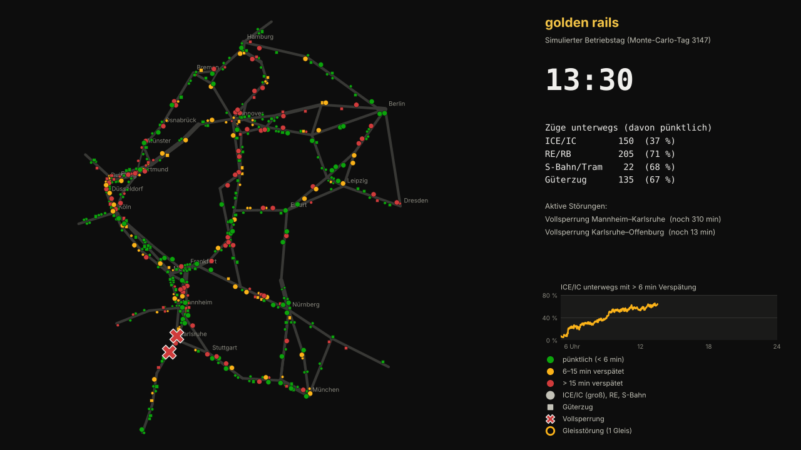

<p align="center"></p>

# golden-rails

**Question:** where in the German rail network does new infrastructure buy the most delay reduction per euro?

**KPI:** cumulative **passenger delay** saved per year ÷ annual cost (capex annuity + opex).
Passenger delay = Σ over trains and stops of *arrival delay × passengers expected to alight there*.
Demand is held fixed, so ranking by this is identical to ranking by average delay per expected passenger.

## Answer (current model run, 200 Monte-Carlo days per refined option)

### Most valuable new track km: **a 3rd track Mannheim–Karlsruhe (70 km)**

| | |
|---|---|
| Capex (cost model) | €1.35 bn: construction €1.23 bn, land €52 m, ETCS on the new track €70 m |
| Passenger delay saved | **62.9 m passenger-min/year**; average delay per passenger −9 s network-wide |
| KPI | **1,390 passenger-min per €1,000** (95% CI 1,230–1,560) ≈ **€0.72 per passenger-minute** |
| Who gains | ICE (92k pax-min/day), RE (61k), S-Bahn Rhein-Neckar (37k) |

Mannheim–Karlsruhe carries ~280 trains/day on two tracks: ICE, RE, S-Bahn and ~160 freight trains (Rhine–Alpine corridor).
Under the priority rule the S-Bahn and freight wait for every ICE. A third track lets them be overtaken without stopping.
Part of the benefit comes from rare long closures, where the third track keeps traffic moving
(see the jump at day 40 in `results/convergence.png`). That is why the estimate needed many simulated days.

| # | Option | km | Capex €m | pax-min saved/yr | pax-min/€1,000 (95% CI) |
|---|---|---|---|---|---|
| 1 | +1 track Mannheim–Karlsruhe | 70 | 1,351 | 62.9 m | 1,392 (1,225–1,560) |
| 2 | +1 track Hanau–Gelnhausen | 20 | 411 | 16.0 m | 1,175 (1,045–1,304) |
| 3 | +1 track Lüneburg–Uelzen | 35 | 634 | 22.2 m | 1,032 (921–1,143) |
| 4 | +1 track Uelzen–Celle | 50 | 856 | 27.2 m | 927 (858–997) |
| – | best planned project: Alpha-E 3rd track Lüneburg–Uelzen–Celle | 85 | 2,000 | 46.3 m | 719 (676–761) |

#1 is now statistically separated from #3 and #4, and only just overlaps #2.
A second extra track (+2) on the same corridors roughly halves the KPI (Mannheim–Karlsruhe 745, Hanau–Gelnhausen 649).

### Cheaper than any new km: ETCS

ETCS on an existing corridor (headway 3 → 2 min, constant €1 m per track-km) is the strongest lever. On the same
corridor it beats a third track by **6–9×**.
Examples: ETCS Hanau–Gelnhausen ≈ 10,500 pax-min/€1,000, Mannheim–Karlsruhe ≈ 9,200, Lüneburg–Uelzen ≈ 6,500.
With a more conservative 2.5-min ETCS headway the advantage shrinks to 3.5–6× but holds
(`results/candidates_etcs2.5.csv`).

ETCS and a new track are **substitutes, not complements**. Adding the track *after* ETCS is in place is still worth it on
Mannheim–Karlsruhe (708 pax-min/€1,000), Lüneburg–Uelzen (529), Uelzen–Celle (460) and Hanau–Gelnhausen (409), see
`results/track_after_etcs_tracks.csv`. Recommended order: ETCS first, then the third track on these corridors.

### Planned projects (BVWP / Deutschlandtakt), published capex

| Project | km | Capex €m | pax-min saved/yr | pax-min/€1,000 |
|---|---|---|---|---|
| 3. Gleis Lüneburg–Uelzen–Celle (Alpha-E) | 85 | 2,000 | 46.3 m | 719 |
| NBS Mannheim–Karlsruhe | 70 | 4,000 | 68.1 m | 544 |
| NBS Hamburg–Hannover (A7-Trasse) | 125 | 9,000 | 104.1 m | 382 |
| NBS Nürnberg–Würzburg | 80 | 5,000 | 58.0 m | 376 |
| ABS/NBS Hanau–Gelnhausen–Fulda | 65 | 4,300 | 48.3 m | 367 |
| NBS Frankfurt–Mannheim | 85 | 5,500 | 49.3 m | 292 |
| RRX viergleisig Duisburg–Dortmund | 52 | 3,000 | 23.1 m | 247 |
| Nürnberg–Bamberg viergleisig | 60 | 2,000 | 14.4 m | 208 |
| 2. Gleis Rotenburg–Verden | 25 | 500 | 3.0 m | 179 |
| Rheintalbahn Offenburg–Freiburg viergleisig | 65 | 4,500 | 23.7 m | 173 |
| NBS Fulda–Gerstungen | 60 | 4,000 | 18.0 m | 147 |
| NBS Ulm–Augsburg | 80 | 5,500 | 14.2 m | 85 |
| 2. Gleis Münster–Lünen | 60 | 900 | 2.0 m | 63 |
| 3. Gleis Emmerich–Oberhausen | 70 | 2,500 | 2.4 m | 31 |
| NBS Hannover–Bielefeld | 95 | 9,000 | 7.5 m | 28 |

Figures: `results/kpi_ranking_new_track.png`, `results/kpi_ranking_all.png`, `results/network_map.png`,
`results/punctuality_cost_curve.png`, `results/convergence.png`.

### Monte-Carlo sample sizes

| Run | simulated days per scenario |
|---|---|
| Screening of all 439 scenarios | 32 |
| Refinement (top 30 corridor options + 15 planned projects; top 20 track options) | 200 |
| ETCS sensitivity (2.5-min headway) | 100 |
| Punctuality cost curve and operational levers | 100 |

Each scenario uses the same random days as the baseline (common random numbers), so differences are paired.
Daily paired savings are in `results/per_day*.csv`.

### Example clip of one simulated day

`results/clip_day.mp4` (25 s, 05:00–24:00) shows Monte-Carlo day 3147. From 11:54, Mannheim–Karlsruhe has a
6.8-hour full closure; from 12:46, Karlsruhe–Offenburg is closed for one hour as well. Trains are coloured by delay
against the timetable (green < 6 min, yellow 6–15, red > 15); active incidents appear on the map.
Regenerate with `python -m golden_rails.clip --seed 3147` (any seed works).

<p align="center"></p>


## Was kostet 95 % Pünktlichkeit? (`golden_rails/punctuality.py`)

Die Korridormaßnahmen werden in der Reihenfolge ihres Kosten-Nutzen-Werts zu immer größeren Paketen kumuliert.
Jedes Paket wird simuliert (100 Tage). Pünktlichkeit = Anteil < 6 min verspätet, wie bei DB.

| Infrastrukturpaket | Capex | Jahreskosten | ICE/IC (Halte) | Alle Fahrgäste |
|---|---|---|---|---|
| Heute | – | – | 61,7 % | 86,9 % |
| bis €2 Mrd. | €1,9 Mrd. | €51 Mio. | 67,1 % | 88,7 % |
| bis €8 Mrd. | €7,1 Mrd. | €207 Mio. | 71,6 % | 90,4 % |
| bis €32 Mrd. | €30,5 Mrd. | €968 Mio. | 77,9 % | 92,5 % |
| bis €128 Mrd. | €128 Mrd. | €4,1 Mrd. | 85,4 % | 94,4 % |
| bis €256 Mrd. | €255 Mrd. | €8,2 Mrd. | 88,0 % | **95,0 %** |
| Maximum: ETCS + 2 Gleise überall | €354 Mrd. | €11,2 Mrd. | **88,4 % (Obergrenze)** | 95,2 % |

* **95 % aller Fahrgäste nur mit Infrastruktur:** ≈ €255 Mrd., also praktisch jeder Korridor ausgebaut. Unrealistisch.
* **95 % im Fernverkehr nur mit Infrastruktur:** nicht erreichbar, maximal ≈ 88 %. Den Rest verursachen
  Primärverspätungen (verspätete Abfahrt, verlängerte Haltezeiten), die kein Gleis verhindert.
* **Kombination** (`results/punctuality_levers.csv`): Anteil der Züge mit Primärverspätung reduziert um …

| | −50 % | −75 % | −90 % |
|---|---|---|---|
| heutige Infrastruktur: ICE/IC / alle Fahrgäste | 76,0 % / 92,1 % | 85,3 % / **95,3 %** | 91,8 % / 97,5 % |
| + Paket €8 Mrd. | 84,0 % / 94,7 % | 90,8 % / 97,0 % | **95,0 %** / 98,4 % |
| + Paket €32 Mrd. | 88,1 % / **95,9 %** | 93,4 % / 97,8 % | **96,5 %** / 98,8 % |

  Weniger Störungen an der Infrastruktur selbst (Weichen, Signale, Personen im Gleis) bringen nur 1–2 Punkte.

**Lesart:** 95 % der Fahrgäste ≈ **€8–32 Mrd. Infrastruktur plus Halbierung der Primärverspätungen**.
95 % im Fernverkehr ≈ **€8–32 Mrd. plus 75–90 % weniger Primärverspätungen**.

**Wichtige Einschränkung:** Das Modell kennt keine Knoten (Köln, Frankfurt, Hamburg) und keine Baustellen. Bei der
Kalibrierung landet deshalb ein Teil der realen infrastrukturbedingten Verspätung in den „Primärverspätungen“.
Der Infrastrukturanteil ist damit eher unterschätzt. Die Kosten der betrieblichen Hebel (Fahrzeugreserve,
Wartung, Personal, Haltezeitmanagement) sind nicht bepreist.

## Corridor model

* **Corridor width = number of tracks.** Each corridor (106 segments, `data/segments.csv`) has n tracks:
  n//2 per direction, and an odd track is bidirectional (overtaking / counter-peak).
  Any width is allowed, so options of +1 and +2 tracks are tested everywhere, including 4 → 6.
* **Train types and the standard priority rule:** ICE/IC > RE/RB > S-Bahn/tram-train > cargo.
  The rule applies when the timetable is built, and in operations: a dispatcher looks 15 min ahead and holds a
  lower-priority train if it would delay an approaching higher-priority train on the same track.
  Priority dispatching lifts ICE punctuality by ~12 points at the expense of freight (tested in `tests/`).
* **Signalling:** headway 3 min conventional, 2 min with ETCS L2 (`GR_HEADWAY_ETCS` to override).
  New infrastructure is always built with ETCS.
* **Timetable:** 27 ICE/IC lines with expected loads, 20 freight corridors, RE and S-Bahn/tram-train services:
  ~8,000 trains/day. The current timetable is kept fixed in every scenario; only trains whose route changes
  (e.g. onto a new line) are re-slotted.
* **Standard disruptions:** origin delays, dwell extensions, running-time noise, track faults (one track blocked,
  forcing wrong-line working) and full closures with rerouting.
  Calibrated to DB punctuality: ICE/IC 61.9% (DB ≈ 62%), RE 90.4% (≈ 90%), S-Bahn 92%, cargo 75%.
* **Passengers:** load per train by line (160–420 on ICE/IC; RE 140, S-Bahn 90, more in metro areas),
  times a peak/off-peak profile. Long-distance passengers alight evenly over a line's stops.
  Freight has zero passenger weight by default (`FREIGHT_PAX_EQUIV`); its train-delay minutes are still reported.

## Cost model (`golden_rails/costs.py`)

Cost of one added track-km:

```
construction = €12 m × terrain factor × land-use complexity
land         = added corridor width (4.5 m per track) × 1 km × land price
ETCS         = €1 m per track-km, constant (independent of terrain and land use)
```

| Terrain | factor | | Land use | complexity | land €/m² |
|---|---|---|---|---|---|
| flat | 1.0 | | open (unbuilt) | 1.0 | 6 |
| rolling | 1.3 | | protected / forest | 1.3 | 6 |
| hilly | 1.9 | | suburban (built) | 1.6 | 180 |
| mountainous | 3.2 | | urban (dense built) | 2.8 | 700 |

Each corridor has a terrain class and land-use shares in `segments.csv`. Resulting costs range from about
€14 m/km (flat, open) through about €31 m/km (Ruhr, urban) to about €54 m/km (Middle Rhine gorge).

Annualisation: 1.7% discount rate over 60 years (BVWP 2030), plus €130k opex per added track-km and year.

## Caveats

* **Curated data, not GTFS/OSM.** The sandbox had no access to the national timetable feed or OSM. Track counts,
  frequencies, freight volumes, passenger loads, terrain and land-use shares are hand-curated approximations.
* Stations and nodes have no capacity limit; node projects (Köln, Hamburg, Frankfurt) are out of scope.
* No transfers, rolling-stock or crew turnarounds, or construction sites. Demand is fixed.
* ETCS: no migration or vehicle-fitment costs, and only the headway effect is modelled.
* Planned-project capex values are rounded public estimates (±50%).

## Run

```bash
pip install -r requirements.txt
python -m golden_rails.evaluate                     # screen 439 scenarios (32 days), refine top 30 (200 days), ~100 min on 4 cores
python -m golden_rails.evaluate --refine-options T1,T2,T1E --top 20 --tag _tracks   # refine track-building options
GR_HEADWAY_ETCS=2.5 python -m golden_rails.evaluate --refine-options E,T1 --top 24 --seeds 40 --tag _etcs2.5
python -m golden_rails.punctuality             # cost to reach 95 % punctuality (100 days), ~25 min
python -m golden_rails.clip --seed 3147          # MP4 clip of one simulated day, ~1 min
python -m golden_rails.plots
pytest -q
```
