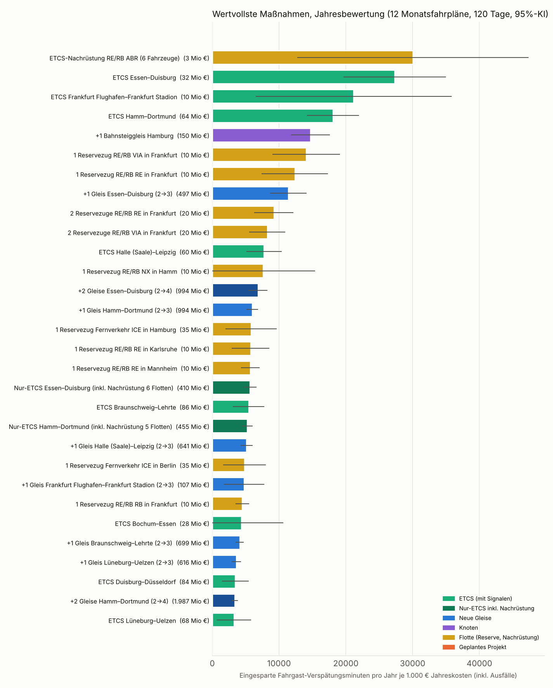
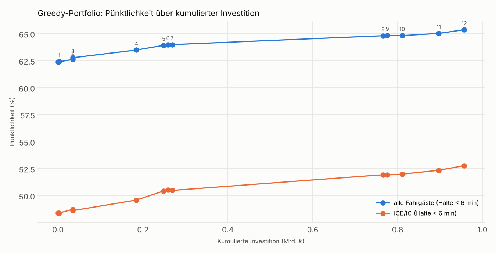

<p align="center"></p>

# golden-rails

**Question:** which measures in the German rail network buy the most delay reduction per euro?
New tracks, ETCS, node capacity, fleet (reserve trains, ETCS retrofit) and a slightly softened timetable compete
on one scale.

**KPI:** cumulative **passenger delay** saved per year (cancellations included) ÷ annual cost (capex annuity + opex).
Passenger delay = Σ over trains and stops of *arrival delay × passengers expected to alight there*; a cancelled stop
counts as the wait for the next train plus the breakdown time (capped at 150 min).

Model explainer (78 s): `results/model_explainer.mp4`.

## Answer: year evaluation (12 monthly timetables Nov 2025 – Oct 2026)

Every simulated day runs on the DB timetable of its month; scenarios share random days with the baseline
(common random numbers). 608 measures were screened (24 days each), the best 40 plus the ETCS-only variants of the
12 best ETCS corridors, all planned projects and the timetable softening were refined (**120 days each**),
and a portfolio was built greedily with interactions re-simulated at every step (36 days per step).

Baseline (model, 120 days): 11.3 m passenger-delay minutes per day, of which 1.2 m from cancellations;
punctuality ICE/IC 48.1 %, RE/RB 68.0 %, S-Bahn 75.9 %, all passengers 62.3 %.

<p align="center"></p>

| Measure | Capex €m | Annual cost €m | pax-min saved/yr | pax-min/€1,000 (95% CI) | ICE/IC punct. |
|---|---|---|---|---|---|
| Timetable softening (±3 min, same arrivals per hour and node) | 0 | 0 | 6.4 m | free (not significant) | +0.03 pp |
| ETCS retrofit RE/RB fleet Eisenach–Erfurt (6 units)¹ | 3 | 0.1 | 4.5 m | 30,039 (12,731–47,347) | +0.01 pp |
| **ETCS Essen–Duisburg** | 32 | 1.9 | 51.9 m | **27,312** (19,636–34,988) | +0.47 pp |
| ETCS Frankfurt Airport–Frankfurt Stadion | 10 | 0.6 | 12.6 m | 21,176 (6,517–35,835) | +0.17 pp |
| **ETCS Hamm–Dortmund** | 64 | 3.8 | 68.7 m | **18,069** (14,162–21,976) | +0.69 pp |
| **+1 platform track Hamburg Hbf** | 150 | 5.0 | 73.7 m | **14,721** (11,814–17,628) | +0.91 pp |
| 1 reserve unit RE/RB (VIAS) in Frankfurt | 10 | 0.9 | 13.1 m | 14,063 (8,987–19,140) | +0.01 pp |
| 1 reserve unit RE/RB (DB Regio) in Frankfurt | 10 | 0.9 | 11.5 m | 12,360 (7,404–17,317) | +0.02 pp |
| **+1 track Essen–Duisburg (2→3)** | 497 | 15.9 | 181.0 m | **11,399** (8,683–14,115) | +1.38 pp |
| ETCS Halle (Saale)–Leipzig | 60 | 3.6 | 27.6 m | 7,754 (5,120–10,387) | +0.33 pp |
| +2 tracks Essen–Duisburg (2→4) | 994 | 31.8 | 217.0 m | 6,832 (5,400–8,264) | +1.84 pp |
| +1 track Hamm–Dortmund (2→3) | 994 | 31.8 | 190.1 m | 5,986 (5,095–6,877) | +1.92 pp |
| 1 reserve ICE in Hamburg | 35 | 2.0 | 11.6 m | 5,812 (1,972–9,652) | +0.06 pp |
| ETCS-only Essen–Duisburg (signals removed, incl. retrofit of 6 fleets) | 410 | 20.1 | 113.1 m | 5,618 (4,633–6,602) | +0.88 pp |
| ETCS Braunschweig–Lehrte | 86 | 5.1 | 27.9 m | 5,458 (3,105–7,811) | +0.36 pp |
| best planned project: RRX four-track Duisburg–Dortmund | 3,000 | 92.1 | 268 m | 2,915 (2,381–3,448) | +2.67 pp |

¹ Eisenach–Erfurt is ETCS-equipped in OSM; only 3 of the 44 daily RB20/RE16 runs use equipped units today, the
others force 3-min headways on the ICEs behind them. The gain depends on that OSM tag; check before acting.

**Readings**

* **The Ruhr main line Dortmund–Hamm–Duisburg is the bottleneck of the network.** ETCS Essen–Duisburg and
  Hamm–Dortmund are the best infrastructure measures, and +1 track Essen–Duisburg is the best new track
  (≈ €31 m/km, urban). The RRX four-track project on the same corridor is the best planned project.
* **ETCS alongside the signals beats ETCS-only.** Removing the signals forces the retrofit of every fleet running
  on the corridor (€300–550 m), which costs far more than the €15k/track-km signal maintenance it saves.
  ETCS-only is 4–5× worse per euro on every tested corridor.
* **Node capacity matters where it is scarce:** +1 platform Hamburg Hbf is the best node measure and the largest
  single gain in ICE/IC punctuality among the cheap measures (+0.9 pp).
* **Reserve trains are cheap and good** where many circulations start (Frankfurt RE/RB, Hamburg/Berlin ICE): one
  unit for €10 m saves about as much per euro as a new track, a second unit at the same node about 30 % less.
* **Timetable softening** (shifts ≤ 3 min, arrivals per hour and node unchanged, freight ≤ 15 min) saves only
  ~20k pax-min/day (± 33k, not significant): the current timetable's buffers are already roughly well placed for the
  disruptions the model represents.
* **Rank stability** (bootstrap over days, `results/year_rank_stability.csv`): the top 8 are in the top 10 in
  ≥ 96 % of resamples; places 9–20 swap.
* **Costs:** a uniform change of our unit costs does not change the ranking among our measures. Against the
  planned projects (published capex), the best planned project drops to rank 42 with our unit costs at the low end
  (×0.6) and rises to rank 25 at the high end (×1.6).

### Portfolio (greedy, interactions re-simulated)

<p align="center"></p>

| Step | Added measure | Cum. capex €m | Cum. annual €m | marginal pax-min/€1,000 | pax-delay min/day | all passengers | ICE/IC |
|---|---|---|---|---|---|---|---|
| 0 | today | 0 | 0 | – | 11.29 m | 62.4 % | 48.4 % |
| 1 | ETCS retrofit RE/RB Eisenach–Erfurt | 3 | 0.1 | 33,477 | 11.28 m | 62.4 % | 48.4 % |
| 2 | ETCS Essen–Duisburg | 35 | 2.1 | 27,183 | 11.12 m | 62.6 % | 48.7 % |
| 3 | timetable softening | 35 | 2.1 | free | 11.11 m | 62.8 % | 48.6 % |
| 4 | +1 platform Hamburg Hbf | 185 | 7.1 | 16,195 | 10.86 m | 63.5 % | 49.6 % |
| 5 | ETCS Hamm–Dortmund | 249 | 10.9 | 15,594 | 10.68 m | 63.9 % | 50.4 % |
| 6 | ETCS Frankfurt Airport–Stadion | 259 | 11.5 | 15,213 | 10.65 m | 64.0 % | 50.5 % |
| 7 | 1 reserve RE/RB (VIAS) Frankfurt | 269 | 12.4 | 9,724 | 10.63 m | 64.0 % | 50.5 % |
| 8 | +1 track Essen–Duisburg | 766 | 28.3 | 8,903 | 10.20 m | 64.8 % | 51.9 % |
| 9 | 1 reserve RE/RB (DB Regio) Frankfurt | 776 | 29.2 | 7,452 | 10.18 m | 64.8 % | 51.9 % |
| 10 | 1 reserve ICE Berlin | 811 | 31.2 | 7,044 | 10.14 m | 64.8 % | 52.0 % |
| 11 | ETCS Braunschweig–Lehrte | 897 | 36.3 | 6,413 | 10.04 m | 65.0 % | 52.4 % |
| 12 | ETCS Halle (Saale)–Leipzig | 957 | 39.9 | 5,880 | 9.97 m | 65.4 % | 52.8 % |

**€1 bn buys −12 % passenger delay (435 m pax-min/year) and +3 pp punctuality** (ICE/IC +4.4 pp).
Interactions are small: marginal values in the portfolio are close to the stand-alone values
(ETCS Hamm–Dortmund after Essen–Duisburg: 180k vs 208k pax-min/day).

### Planned projects (BVWP / Deutschlandtakt), published capex, 120 days

| Project | Capex €m | pax-min saved/yr | pax-min/€1,000 (95% CI) |
|---|---|---|---|
| RRX viergleisig Duisburg–Dortmund | 3,000 | 268 m | 2,915 (2,381–3,448) |
| 3. Gleis Lüneburg–Uelzen–Celle (Alpha-E) | 2,000 | 138 m | 2,141 (1,866–2,416) |
| ABS/NBS Hanau–Gelnhausen–Fulda | 4,300 | 126 m | 974 (845–1,103) |
| NBS Frankfurt–Mannheim | 5,500 | 158 m | 937 (802–1,072) |
| NBS Mannheim–Karlsruhe | 4,000 | 98 m | 785 (673–897) |
| NBS Fulda–Gerstungen (Eisenach) | 4,000 | 75 m | 614 (512–716) |
| Rheintalbahn Offenburg–Freiburg viergleisig | 4,500 | 82 m | 608 (477–739) |
| NBS Nürnberg–Würzburg | 5,000 | 86 m | 557 (453–661) |
| NBS Hamburg–Hannover (A7-Trasse) | 9,000 | 126 m | 462 (391–534) |
| NBS Hannover–Bielefeld | 9,000 | 112 m | 421 (345–497) |
| NBS Ulm–Augsburg | 5,500 | 49 m | 294 (224–364) |
| 2. Gleis Münster–Lünen | 900 | 4 m | 133 (82–184) |
| 3. Gleis Emmerich–Oberhausen | 2,500 | 7 m | 98 (−22–219) |
| 2. Gleis Rotenburg–Verden | 500 | 1 m | 71 (−5–146) |

Nürnberg–Bamberg viergleisig has no effect: OSM shows it as already four-track. Münster–Lünen fell from the top of the
previous (single-day GTFS) model: with the DB monthly timetables and the calibrated corridor delays split by
direction and train type, the delay growth Münster→Dortmund is attributed to the corridor itself, not to
single-track crossings.

## Was kostet 95 % Pünktlichkeit?

Das Greedy-Portfolio zeigt die günstigsten Schritte: **€1 Mrd. bringt +3 Punkte** (alle Fahrgäste 62 → 65 %,
ICE/IC 48 → 53 %), danach sinkt der Grenznutzen auf das Niveau neuer Gleise (≈ 6.000 Fahrgast-min je €1.000).
Die frühere Paketkurve (`results/punctuality_cost_curve.png`, Vormodell ohne Knoten, Flotte und Ausfälle) kam schon
mit Vollausbau aller Korridore nur auf ≈ 87 % (alle) / 75 % (ICE/IC). **95 % sind mit Infrastruktur allein nicht
erreichbar**; nötig sind zusätzlich deutlich weniger Primärverspätungen (Abfahrtsverspätungen, Haltezeiten,
Fahrzeugstörungen). Die Paketkurve wird mit dem neuen Modell noch nicht neu gerechnet.

## Data sources

| What | Source | Used for |
|---|---|---|
| Infrastructure | OpenStreetMap (© OpenStreetMap contributors, ODbL) | track count, length, line speed, ETCS equipment, platform tracks of 44 major nodes |
| Timetable | DB Timetables API planned times via `piebro/deutsche-bahn-data`, one representative Tue–Thu per month, Nov 2025 – Oct 2026 (`data/timetables/`) | 12 monthly timetables of ICE/IC/EC, RE/RB and shared-track S-Bahn; background trains of single nodes |
| Delays and cancellations | same source (CC BY 4.0), 12 months | calibration (even months) and validation (odd months) |
| Running times | GTFS (gtfs.de) and DB planned times | per-corridor running-time factors |
| Freight | curated (20 corridors, 648 trains/day) | – no open per-train data |

## Calibration and validation (`golden_rails/validate.py`)

Calibrated on the even months, validated on the odd months (60 simulated days on their own monthly timetables).
Order: operations (turnaround propagation, vehicle failures against α = 40 % of cancellations) → corridor extra delay
(ICE/IC and regional separately, per direction, joint weighted least squares) → station approach delay → repeat.

| Validation months (out-of-sample) | model | observed | ceiling¹ |
|---|---|---|---|
| ICE/IC punctuality, model stations and trains | 48.2 % | 49.4 % | |
| RE/RB punctuality | 65.8 % | 65.8 % | |
| S-Bahn punctuality | 75.3 % | 80.2 % | |
| Stations ICE/IC (66): r, mean abs. error | 0.82, 4.5 pp | | 0.94 |
| Stations RE/RB (70) | 0.84, 3.4 pp | | 0.96 |
| Delay growth between stations, ICE/IC (330 legs) | r = 0.54, 2.3 min | | 0.95 |
| Delay growth between stations, RE/RB (241 legs) | r = 0.55, 1.5 min | | |
| Cancellations by vehicle (share of stops) FV / NV / S | 1.7 / 1.0 / 1.4 % | 2.0 / 1.0 / 1.4 % | |
| Month-to-month changes per station (ICE/IC) | r = 0.27 | | |

¹ Correlation of the observed values between calibration and validation months: the best any model can reach.

The model is good at **which stations are unpunctual** and fair at **where along the line** delay builds up.
It barely explains month-to-month changes (construction sites are not modelled individually), and two
closure backtests found no correlation. Results are therefore structural ("which bottleneck matters on average
over a year"), not forecasts for a specific month.

## Model (`golden_rails/sim.py`)

* **Mesoscopic block simulation:** each corridor has n tracks; follower headway 3 min, 2 min with ETCS **only
  for equipped trains** (mixed traffic keeps 3 min). ETCS-only corridors admit equipped trains only.
* **Nodes:** platform tracks and throat route groups are exclusive resources (`data/nodes_capacity.csv`).
* **Circulations:** vehicle rotations inferred from the timetable (minimum turnaround ICE/IC 10, RE/RB 5,
  S-Bahn 3 min); delay propagates through turnarounds; hot reserves can replace late or failed units.
* **Vehicle failures** before departure (cancellation) and en route (track blocked, rest of the run cancelled).
* **Dispatching:** conflict-free timetable by priority (ICE/IC > RE/RB > S-Bahn > freight); in operation a
  dispatcher holds lower-priority trains for approaching higher-priority ones.
* **Timetable softening** (`timetable_opt.py`): local search on buffer penalties, shifts ≤ 3 min passenger /
  15 min freight, train counts per hour, node and category unchanged.
* **Measures and costs** (`measures.py`): ETCS €1.0 m/track-km (ETCS-only €0.8 m plus retrofit of all fleets on the
  corridor, €0.4–0.6 m per vehicle), platform track €150 m, flyover €250 m, node ETCS €40 m + €3 m per platform,
  reserve unit €8–35 m + €0.5 m/yr standby, new tracks from the cost model below. Annuity at 1.7 %, lifetimes
  60 (infra) / 30 (vehicles) / 25 years (ETCS, on-board units).

## Cost model (`golden_rails/costs.py`)

Cost of one added track-km:

```
construction = €12 m × terrain factor × land-use complexity
land         = added corridor width (4.5 m per track) × 1 km × land price
ETCS         = €1 m per track-km, constant (independent of terrain and land use)
```

| Terrain | factor | | Land use | complexity | land €/m² |
|---|---|---|---|---|---|
| flat | 1.0 | | open (unbuilt) | 1.0 | 6 |
| rolling | 1.3 | | protected / forest | 1.3 | 6 |
| hilly | 1.9 | | suburban (built) | 1.6 | 180 |
| mountainous | 3.2 | | urban (dense built) | 2.8 | 700 |

Each corridor has a terrain class and land-use shares in `segments.csv`. Resulting costs range from about
€14 m/km (flat, open) through about €31 m/km (Ruhr, urban) to about €54 m/km (Middle Rhine gorge).

Annualisation: 1.7% discount rate over 60 years (BVWP 2030), plus €130k opex per added track-km and year.


## Caveats

* **Freight is curated**, passenger loads are per train type, not measured. Demand is fixed.
* **Construction sites** are only contained implicitly in the calibrated corridor delay; they are not measures.
* **Vehicle share of cancellations** (α = 40 %) is an assumption; the rest of the cancellations is treated as
  exogenous.
* **ETCS equipment** of corridors comes from OSM tags and the fleet equipment shares are estimates (ICE 80 %,
  IC/EC 30 %, regional 5 %); single results that hinge on them (Eisenach–Erfurt retrofit) need checking.
* Unit costs are planning assumptions (range ×0.6 – ×1.6); planned-project capex are rounded public estimates.
* Short modelled links (Frankfurt Airport–Stadion) and single-corridor results deserve a detailed timetable study.

## Run

```bash
pip install -r requirements.txt
python -m golden_rails.data_db_timetable 2025-11 2025-12 ...   # monthly timetables from DB planned times
python -m golden_rails.data_delays <parquet> <outdir>  # observed statistics per month
python -m golden_rails.validate --calibrate          # calibration on even months
python -m golden_rails.validate --obs data/observed_val --tag _val   # validation on odd months
python -m golden_rails.evaluate_year shifts          # timetable softening per month
python -m golden_rails.evaluate_year screen          # ~3 h on 4 cores, resumable (results/ckpt/)
python -m golden_rails.evaluate_year refine          # ~1.5 h
python -m golden_rails.evaluate_year greedy --steps 12
python -m golden_rails.report_year                   # figures, rank stability, cost sensitivity
python -m golden_rails.explainer                     # model explainer video
pytest -q
```

Data licences: OpenStreetMap data © OpenStreetMap contributors (ODbL). Delay and timetable data from DB Timetables
API via piebro/deutsche-bahn-data (CC BY 4.0). GTFS from gtfs.de.
