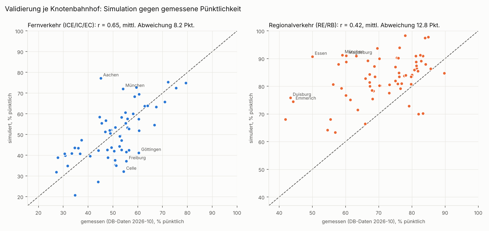

<p align="center"></p>

# golden-rails

**Question:** where in the German rail network does new infrastructure buy the most delay reduction per euro?

**KPI:** cumulative **passenger delay** saved per year ÷ annual cost (capex annuity + opex).
Passenger delay = Σ over trains and stops of *arrival delay × passengers expected to alight there*.
Demand is held fixed, so ranking by this is identical to ranking by average delay per expected passenger.

## Answer (real data: OSM, GTFS timetable, DB delay data; 200 Monte-Carlo days per refined option)

### Most valuable new track km: **a 3rd track Bochum–Essen (14 km)**

| | |
|---|---|
| Capex (cost model) | €435 m: construction €390 m, land €31 m, ETCS on the new track €14 m (≈ €31 m per km, dense urban Ruhr) |
| Passenger delay saved | **54.4 m passenger-min/year**; average delay per passenger −10 s network-wide |
| KPI | **4,050 passenger-min per €1,000** (95% CI 3,530–4,570) ≈ **€0.25 per passenger-minute** |
| Who gains | RE/RB (125k pax-min/day), ICE/IC (40k) |
| With ETCS on the whole corridor | 4,490 pax-min/€1,000 (3,980–4,990), capex €463 m |

According to the GTFS timetable, Bochum–Essen carries ~490 trains/day on its two main-line tracks: 113 ICE/IC and
~380 RE/RB, including the RRX lines. The S-Bahn runs on its own tracks, and OSM confirms 2 main-line tracks.
This is the busiest two-track main line in the model. One more track lets RE trains get out of the way of ICEs and
absorbs knock-on delays in the peak.

| # | Option (new track) | km | Capex €m | pax-min saved/yr | pax-min/€1,000 (95% CI) |
|---|---|---|---|---|---|
| 1 | +1 track Bochum–Essen (2→3) | 14 | 435 | 54.4 m | 4,048 (3,529–4,566) |
| 2 | +1 track Frankfurt Airport–Frankfurt Stadion (2→3) | 5 | 107 | 12.8 m | 3,637 (3,219–4,055) |
| 3 | +1 track Münster–Dortmund (1→2, single-track section Münster–Lünen) | 52 | 1,055 | 105.7 m | 3,024 (2,826–3,222) |
| 4 | +1 track Essen–Duisburg (2→3) | 16 | 497 | 36.0 m | 2,344 (2,030–2,657) |
| 5 | +1 track Mannheim–Karlsruhe (2→3) | 67 | 1,293 | 94.5 m | 2,185 (2,085–2,285) |
| 6 | +1 track Hildesheim–Hannover (2→3) | 30 | 866 | 55.5 m | 2,053 (1,948–2,157) |
| – | best planned project: 2nd track Münster–Lünen (published capex) | 52 | 900 | 105.7 m | 3,431 (3,207–3,655) |

* **#1 and #2 are statistically tied**; #1 is separated from #3 onwards. #2 is a short modelled link (the
  airport's connection towards the Riedbahn via Frankfurt Stadion). Its length and track layout are less
  certain, and the simulation over-predicts delay growth on Frankfurt Airport → Mannheim compared with DB data
  (+0.9 vs −1.6 min). Read #2 as "check the Stadion node", not as a ready project.
* **The strongest signal from the observed data is #3, Münster–Lünen.** Apart from Rotenburg–Verden it is the only
  single-track corridor in the model, and DB data shows trains losing **+4.3 min (IC) / +3.0 min (RE)** between Münster and
  Dortmund. This makes the planned 2nd track the best planned project (rank 13 of 15 in the curated model).
  The estimate is conservative: in the model, ICs between Münster and Dortmund still run via Hamm.
* **A second extra track** on the same corridor roughly halves the KPI (Bochum–Essen 2→4: 2,534).
* **Compared with the curated model** (before real data): Mannheim–Karlsruhe dropped from #1 to #5.
  Hanau–Gelnhausen dropped out: OSM shows 3 tracks already, and ICEs Frankfurt–Würzburg run via Aschaffenburg,
  not via Fulda.

### Cheaper than any new km: ETCS

ETCS on an existing corridor (headway 3 → 2 min, constant €1 m per track-km) remains by far the strongest lever.
On Bochum–Essen it beats the third track by **15×**:

| ETCS on | Capex €m | pax-min/€1,000 (95% CI) |
|---|---|---|
| Bochum–Essen | 28 | 61,027 (56,052–66,003) |
| Essen–Duisburg | 32 | 36,002 (31,268–40,736) |
| Frankfurt Airport–Frankfurt Stadion | 10 | 30,186 (24,991–35,381) |
| Hamm–Dortmund | 64 | 24,287 (20,802–27,773) |
| Hildesheim–Hannover | 60 | 18,150 (16,340–19,960) |
| Halle (Saale)–Leipzig | 60 | 18,069 (17,179–18,958) |

With a more conservative 2.5-min ETCS headway, ETCS Bochum–Essen still reaches 40,790 pax-min/€1,000, 11× the
third track (`results/candidates_etcs2.5.csv`, 40 days).

ETCS and a new track are **substitutes, not complements**. Even after ETCS is in place, the track is still worth it
(`results/track_after_etcs_tracks.csv`): Münster–Dortmund 2,357 pax-min/€1,000, Frankfurt Airport–Stadion 1,478,
Bochum–Essen 1,337, Mannheim–Karlsruhe 1,099, Hildesheim–Hannover 1,075.
**Recommended order: ETCS on the Ruhr main line first, then the 2nd track Münster–Lünen and the 3rd track Bochum–Essen.**

### Planned projects (BVWP / Deutschlandtakt), published capex

| Project | km | Capex €m | pax-min saved/yr | pax-min/€1,000 |
|---|---|---|---|---|
| 2. Gleis Münster–Lünen | 52 | 900 | 105.7 m | 3,431 |
| RRX viergleisig Duisburg–Dortmund | 46 | 3,000 | 151 m | 1,635 |
| 3. Gleis Lüneburg–Uelzen–Celle (Alpha-E) | 85 | 2,000 | 72 m | 1,116 |
| NBS Mannheim–Karlsruhe | 70 | 4,000 | 97 m | 777 |
| ABS/NBS Hanau–Gelnhausen–Fulda | 64 | 4,300 | 84 m | 652 |
| NBS Frankfurt–Mannheim | 85 | 5,500 | 80 m | 475 |
| NBS Fulda–Gerstungen (Eisenach) | 60 | 4,000 | 51 m | 420 |
| NBS Ulm–Augsburg | 80 | 5,500 | 47 m | 278 |
| NBS Nürnberg–Würzburg | 80 | 5,000 | 43 m | 277 |
| NBS Hannover–Bielefeld | 95 | 9,000 | 73 m | 275 |
| NBS Hamburg–Hannover (A7-Trasse) | 125 | 9,000 | 64 m | 235 |
| Rheintalbahn Offenburg–Freiburg viergleisig | 59 | 4,500 | 20 m | 148 |
| 2. Gleis Rotenburg–Verden | 25 | 500 | 1 m | 72 |
| 3. Gleis Emmerich–Oberhausen | 58 | 2,500 | 2 m | 31 |

Nürnberg–Bamberg viergleisig is skipped: OSM shows it as already four-track.

Figures: `results/kpi_ranking_new_track.png`, `results/kpi_ranking_all.png`, `results/network_map.png`,
`results/punctuality_cost_curve.png`, `results/convergence.png`, `results/validation.png`.

### Monte-Carlo sample sizes

| Run | simulated days per scenario |
|---|---|
| Screening of all 450 scenarios | 32 |
| Refinement (top 30 corridor options + 14 planned projects; top 20 track options + their ETCS variants) | 200 |
| ETCS sensitivity (2.5-min headway) | 40 |
| Punctuality cost curve and operational levers | 100 |

Each scenario uses the same random days as the baseline (common random numbers), so differences are paired.
Daily paired savings are in `results/per_day*.csv`.

### Example clip of one simulated day

`results/clip_day.mp4` (25 s, 05:00–24:00) shows Monte-Carlo day 3147 on the real timetable. From 04:17, one track
Heidelberg–Karlsruhe is blocked for 3.5 hours. From 11:54, Mannheim–Karlsruhe has a 6.8-hour full closure.
Trains are coloured by delay against the timetable (green < 6 min, yellow 6–15, red > 15); active incidents appear
on the map. Regenerate with `python -m golden_rails.clip --seed 3147` (any seed works).

<p align="center"></p>


## Was kostet 95 % Pünktlichkeit? (`golden_rails/punctuality.py`)

Die Korridormaßnahmen werden in der Reihenfolge ihres Kosten-Nutzen-Werts zu immer größeren Paketen kumuliert.
Jedes Paket wird simuliert (100 Tage). Pünktlichkeit = Anteil der Halte mit < 6 min Verspätung, wie bei DB.
Ausgangslage im Modell: ICE/IC 47 % (gemessen Okt. 2026: 53 %, Sep.: 48 %).

| Infrastrukturpaket | Capex | Jahreskosten | ICE/IC (Halte) | Alle Fahrgäste |
|---|---|---|---|---|
| Heute | – | – | 47,2 % | 67,7 % |
| bis €2 Mrd. | €2,0 Mrd. | €55 Mio. | 52,2 % | 73,0 % |
| bis €8 Mrd. | €6,7 Mrd. | €194 Mio. | 56,3 % | 76,6 % |
| bis €32 Mrd. | €32,0 Mrd. | €1,0 Mrd. | 63,7 % | 81,6 % |
| bis €128 Mrd. | €125 Mrd. | €4,0 Mrd. | 72,0 % | 86,1 % |
| bis €256 Mrd. | €251 Mrd. | €8,0 Mrd. | 74,4 % | 87,0 % |
| Maximum: ETCS + 2 Gleise überall | €366 Mrd. | €11,6 Mrd. | **74,5 % (Obergrenze)** | **87,1 % (Obergrenze)** |

* **95 % nur mit Infrastruktur: nicht erreichbar**, weder für alle Fahrgäste (max. ≈ 87 %) noch im Fernverkehr
  (max. ≈ 75 %). Mit echten Verspätungsdaten ist die Ausgangslage deutlich schlechter als im kuratierten Modell, und
  ein größerer Teil der Verspätung entsteht unabhängig von der Kapazität.
* **Kombination** (`results/punctuality_levers.csv`): Anteil der Züge mit Primärverspätung (verspätete Abfahrt,
  verlängerte Haltezeit) reduziert um …

| ICE/IC / alle Fahrgäste | −50 % | −75 % | −90 % |
|---|---|---|---|
| heutige Infrastruktur | 61,0 % / 77,1 % | 70,6 % / 83,0 % | 77,6 % / 87,2 % |
| + Paket €8 Mrd. | 71,3 % / 85,4 % | 80,1 % / 90,3 % | 86,0 % / 93,4 % |
| + Paket €32 Mrd. | 78,0 % / 89,2 % | 85,8 % / 93,2 % | 90,7 % / **95,6 %** |
| + Maximum (€366 Mrd.) | 86,4 % / 93,1 % | 92,2 % / **96,0 %** | **95,6 %** / 97,7 % |

  Weniger Störungen an der Infrastruktur selbst (Weichen, Signale, Personen im Gleis) bringen nur ≈ 1 Punkt.

**Lesart:** 95 % der Fahrgäste ≈ **€32 Mrd. Infrastruktur plus 90 % weniger Primärverspätungen**.
95 % im Fernverkehr ist praktisch nur mit **Vollausbau plus 90 % weniger Primärverspätungen** erreichbar.

**Einschränkung:** Selbst ohne jede Primärverspätung bleiben bei heutiger Infrastruktur nur 83 % (ICE/IC) bzw.
90 % (alle Fahrgäste). Der Grund ist die kalibrierte Zusatzverspätung je Korridor und Bahnhof. Sie steht für
Baustellen, Langsamfahrstellen und Knotenkonflikte, die das Modell nicht einzeln abbildet, und wird von keinem der
Hebel adressiert. Die Kosten der betrieblichen Hebel (Fahrzeugreserve, Wartung, Personal, Haltezeitmanagement)
sind nicht bepreist.

## Data sources

| What | Source | Used for |
|---|---|---|
| Infrastructure | OpenStreetMap (© OpenStreetMap contributors, ODbL), Germany extract: 225,821 `railway=rail` ways, 83,404 km | track count (lower quartile along each corridor = bottleneck), length, line speed, ETCS equipment |
| Timetable | GTFS from gtfs.de (long-distance and regional feeds), reference day Tue 24 Nov 2026 | 659 ICE/IC/EC, 4,064 RE/RB and 2,227 S-Bahn trips, reduced to the model's 76 nodes; running times |
| Delays | DB Timetables API via `piebro/deutsche-bahn-data` (CC BY 4.0): Oct 2026 (14.7 m stop events) for calibration, Sep 2026 (14.4 m) for validation | entry delays, station punctuality, delay growth between consecutive stations |
| Freight | curated (20 corridors, 648 trains/day) | – no open per-train data |

The model network has 111 corridors between 76 nodes. Five corridors were added because GTFS trains
otherwise took detours: the airport link towards the Riedbahn via Frankfurt Stadion, Berlin–Magdeburg via
Brandenburg, Hanau–Würzburg via Aschaffenburg, Augsburg–Nürnberg via Treuchtlingen, and Hildesheim–Braunschweig.
OSM values replace the curated ones where they are plausible: length within ±20%, mostly electrified, high-speed
share on new lines. Metro corridors with separate S-Bahn tracks keep the curated main-line track count.
The simulated day has ~6,050 trains: S-Bahn trips are kept only where the S-Bahn shares main-line tracks.

Pipeline: `golden_rails/data_osm.py` → `osm_network.py --apply`, `data_gtfs.py` (timetable, running-time factors),
`data_delays.py` (observed statistics, `data/observed*/`), `validate.py --calibrate`.

## Calibration and validation (`golden_rails/validate.py`)

1. **Running times:** per-corridor factors (ICE/IC and regional separately), fitted by bounded least squares so
   that model running times match GTFS times minus a 7% recovery margin. Median leg error: ICE/IC 25% → 8%,
   regional 24% → 12%.
2. **Entry delays:** empirical distribution of the departure delay when a train enters the model, per node and type.
3. **Corridor delay:** extra delay per corridor fitted to the observed delay growth between consecutive stations
   (ICE/IC). The fit can only add delay, so it is shrunk by 0.6 to keep the national level right.
4. **Stations:** dwell-extension factors per station and train type fitted to observed punctuality.

| | Oct 2026 (calibration) | Sep 2026 (out-of-sample) |
|---|---|---|
| ICE/IC punctuality, national: simulated / observed | 47.4% / 52.9% | 47.4% / 48.1% |
| RE/RB punctuality, national | 74.6% / 81.0% | 74.6% / 80.7% |
| Stations, ICE/IC (61): correlation, mean abs. error | r = 0.66, 8.4 pts | r = 0.62, 9.3 pts |
| Stations, RE/RB (68) | r = 0.41, 8.8 pts | r = 0.41, 9.2 pts |
| Delay growth between consecutive stations, ICE/IC (~190 legs) | r = 0.22, 2.3 min | r = 0.31, 2.2 min |

Before calibration the station correlations were 0.46 (ICE/IC) and 0.05 (RE/RB).
The model is good at **which stations are unpunctual**, and moderate at **where along the line** delay builds up.
Regional punctuality is about 6 points too pessimistic, so regional benefits are, if anything, overstated.
`results/validation.png`, `results/validation_sep.png`.

<p align="center"></p>

## Corridor model

* **Corridor width = number of tracks.** Each corridor (111 segments, `data/segments.csv`) has n tracks:
  n//2 per direction, and an odd track is bidirectional (overtaking / counter-peak).
  Any width is allowed, so options of +1 and +2 tracks are tested everywhere, including 4 → 6.
* **Train types and the standard priority rule:** ICE/IC > RE/RB > S-Bahn/tram-train > cargo.
  The rule applies when the timetable is built, and in operations: a dispatcher looks 15 min ahead and holds a
  lower-priority train if it would delay an approaching higher-priority train on the same track (tested in `tests/`).
* **Signalling:** headway 3 min conventional, 2 min with ETCS L2 (`GR_HEADWAY_ETCS` to override).
  New infrastructure is always built with ETCS. Corridors already equipped according to OSM start with ETCS.
* **Timetable:** the real GTFS timetable (see above). It is kept fixed in every scenario; only trains whose route
  changes (e.g. onto a new line) are re-slotted. `GR_TIMETABLE=curated` switches back to the hand-made timetable.
* **Standard disruptions:** entry delays (empirical), dwell extensions, running-time noise, calibrated corridor
  delay, track faults (one track blocked, forcing wrong-line working) and full closures with rerouting.
* **Passengers:** load per train by type (ICE 350, IC/EC 250–300, RE/RB 140, S-Bahn 90; +25% when starting/ending
  at a major node), times a peak/off-peak profile, spread evenly over the stops. Freight has zero passenger weight
  by default (`FREIGHT_PAX_EQUIV`); its train-delay minutes are still reported.

## Cost model (`golden_rails/costs.py`)

Cost of one added track-km:

```
construction = €12 m × terrain factor × land-use complexity
land         = added corridor width (4.5 m per track) × 1 km × land price
ETCS         = €1 m per track-km, constant (independent of terrain and land use)
```

| Terrain | factor | | Land use | complexity | land €/m² |
|---|---|---|---|---|---|
| flat | 1.0 | | open (unbuilt) | 1.0 | 6 |
| rolling | 1.3 | | protected / forest | 1.3 | 6 |
| hilly | 1.9 | | suburban (built) | 1.6 | 180 |
| mountainous | 3.2 | | urban (dense built) | 2.8 | 700 |

Each corridor has a terrain class and land-use shares in `segments.csv`. Resulting costs range from about
€14 m/km (flat, open) through about €31 m/km (Ruhr, urban) to about €54 m/km (Middle Rhine gorge).

Annualisation: 1.7% discount rate over 60 years (BVWP 2030), plus €130k opex per added track-km and year.


## Caveats

* **Freight is curated**, not real per-train data. Passenger loads are per train type, not measured.
* **Coverage gaps:** regional trips that touch only one model node are not simulated. S-Bahn networks on their own
  tracks are left out.
* **Weak leg-level fit:** the model reproduces station punctuality well (r ≈ 0.6) but delay growth along the line
  only moderately (r ≈ 0.2–0.3). Single-corridor results (especially short links like Frankfurt Airport–Stadion)
  deserve a detailed timetable study before any decision.
* Stations and nodes have no capacity limit; node projects (Köln, Hamburg, Frankfurt) are out of scope.
  Construction sites are only contained implicitly in the calibrated corridor delay.
* No transfers, rolling-stock or crew turnarounds. Demand is fixed.
* ETCS: no migration or vehicle-fitment costs, and only the headway effect is modelled.
* Planned-project capex values are rounded public estimates (±50%).

## Run

```bash
pip install -r requirements.txt
# real data (downloads into data/raw/, gitignored)
python -m golden_rails.data_osm && python -m golden_rails.osm_network --apply
python -m golden_rails.data_gtfs && python -c "from golden_rails.data_gtfs import runtime_factors; runtime_factors()"
python -m golden_rails.data_delays data/raw/delays/data-2026-10.parquet
python -m golden_rails.validate --calibrate --days 40                                   # fit + validate (Oct)
python -m golden_rails.validate --days 40 --obs data/observed_2026-09 --tag _sep         # out-of-sample (Sep)
# evaluation
python -m golden_rails.evaluate                     # screen 450 scenarios (32 days), refine top 30 (200 days), ~100 min on 4 cores
python -m golden_rails.evaluate --refine-options T1,T2,T1E --top 20 --tag _tracks   # refine track-building options
GR_HEADWAY_ETCS=2.5 python -m golden_rails.evaluate --refine-options E,T1 --top 24 --seeds 40 --tag _etcs2.5
python -m golden_rails.punctuality             # cost to reach 95 % punctuality (100 days)
python -m golden_rails.clip --seed 3147          # MP4 clip of one simulated day, ~1 min
python -m golden_rails.plots
pytest -q
```

Data licences: OpenStreetMap data © OpenStreetMap contributors (ODbL). Delay data from DB Timetables API via
piebro/deutsche-bahn-data (CC BY 4.0). Timetable from gtfs.de.
